# Franky, the Micro Duck: from a scripted robot to an agent that keeps its own notebook

A MuJoCo simulation of **Franky**, a Micro Duck robot (Pollen Robotics' Microduck model), and the story of how we changed its brain over five stages of design and testing, ending with proof videos. The task never changed:

> *Pick the banana and put it in the green box.*

What changed is **how much of that task is done by the language model and how much by code we wrote for it**. We started with code that knew everything, moved the work to the model step by step, and ended with an agent that gets only a camera picture and raw numbers, chooses its own tools, and writes notes to itself between attempts.

This README tells the whole path, with the results and the architectures, in the order we lived it. Every number comes from a log file in `outputs/logs/` or from the project notes; where a number is missing, the text says so.

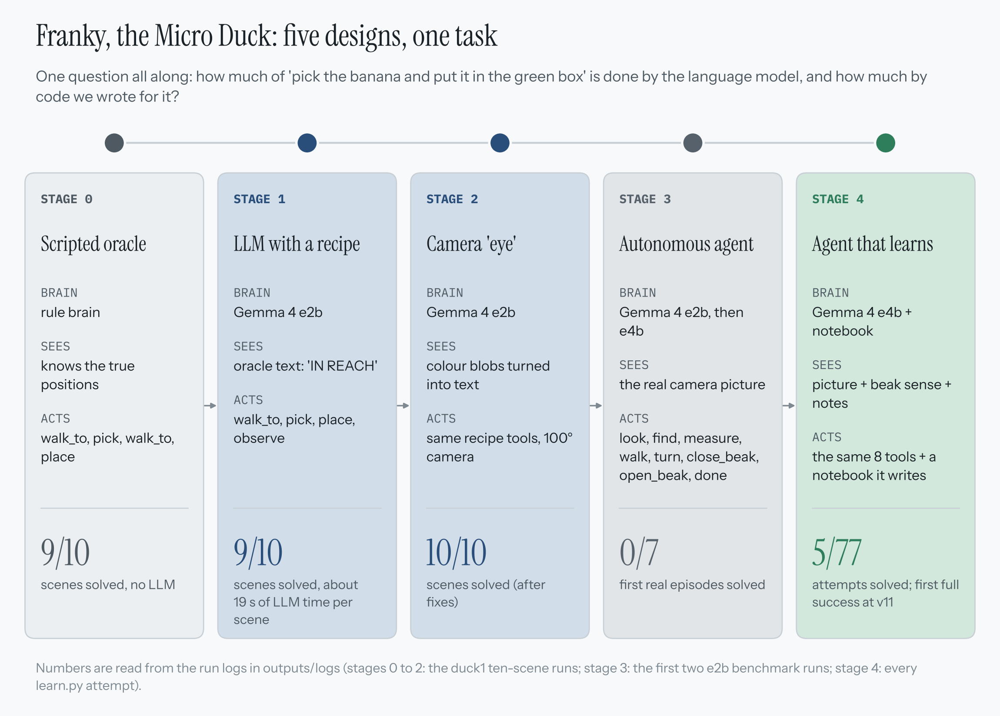

---

## Contents

1. [What we built and tested](#1-what-we-built-and-tested)
2. [Stages 0 to 2: the scripted recipe](#2-stages-0-to-2-the-scripted-recipe)
3. [Choosing the brain: Qwen and Gemma](#3-choosing-the-brain-qwen-and-gemma)
4. [Stage 3: the autonomous agent](#4-stage-3-the-autonomous-agent)
5. [Stage 4: the duck that learns](#5-stage-4-the-duck-that-learns)
6. [Every major change: why, what, result](#6-every-major-change-why-what-result)
7. [The learning duck in cases](#7-the-learning-duck-in-cases)
8. [What is proven, and what is not](#8-what-is-proven-and-what-is-not)
9. [How to run it](#9-how-to-run-it)
10. [Where every number comes from](#10-where-every-number-comes-from)

---

## Results at a glance

| Stage | Brain | What the brain is given | Result |
|---|---|---|---|
| 0 | rule brain (if-statements, no model) | the true positions of everything | 9 of 10 scenes, 7.0 tool calls per scene |
| 1 | Gemma 4 e2b, recipe in the prompt | text from the simulator: "banana: 0.32 m ahead -> NOT in reach" | 9 of 10 scenes, 7.3 calls, about 19 s of model time per scene |
| 2 | Gemma 4 e2b, same recipe | the same kind of text, now made from a camera picture by colour code | first run 8 of 10; the last four runs **10 of 10**, final run 6.2 calls and 16 s per scene |
| 3 | Gemma 4 e2b, **no recipe** (e4b appears only in the pointing test) | the raw camera picture and raw numbers | **0 of 7** benchmark episodes |
| 4 | Gemma 4 e4b + a notebook it writes | picture + beak sense + its notebook | **5 of 77** learner attempts solved |

The honest reading of this table:

* Stages 0 to 2 solve nearly every scene, but the **recipe and our helper code do the geometry**. That a 2B model can follow a recipe is not the same as the model being able to do the task.
* Stage 3 removes the recipe. The model has to find things in its own picture, plan the walk, line the banana up across its beak and carry it. It could not, at first.
* Stage 4 adds the notebook. The duck solved 5 attempts out of 77: three with a notebook in use (one in v11, two in v12), one on a fresh run whose notebook was still empty (v13), and one in the control run **without any notebook**. We cannot show that the notebook is what helped (section 5.3).
* All the Stage 4 successes are on practice scenes with a wider grasp window than the benchmark. The autonomous duck has **never solved a benchmark scene**: 0 of 7 benchmark episodes in Stage 3 and 0 of 13 learner attempts on scene 0.

---

## 1. What we built and tested

**The world.** A MuJoCo simulation of the Microduck (Pollen Robotics model; Pollen's walking and motion layer is kept as it is). The duck stands on a table of 1.2 x 1.0 m, starts at (-0.40, 0) facing +x, and sees through a head camera (raw 800 x 600 picture, it sees about +-50 degrees to each side). The official model has no jaw motor, so the **grasp is simulated**: the banana is attached to the beak tip by code, and it only works when the banana lies **crosswise** across the beak.

**The judge.** A referee reads the **true** simulator state after every call and writes the logs. The duck never sees it. A `done` is judged on the true state: a duck that believes it has finished but dropped the banana on the table counts as failed.

**The scenes.** Fourteen fixed start positions (figure below): scenes 0 to 9 are the **benchmark**; scenes 10 to 13 are **practice scenes** added in Stage 4 so the duck could rehearse the hard parts (the long approach, a close start, carrying the banana to a box that is out of view).

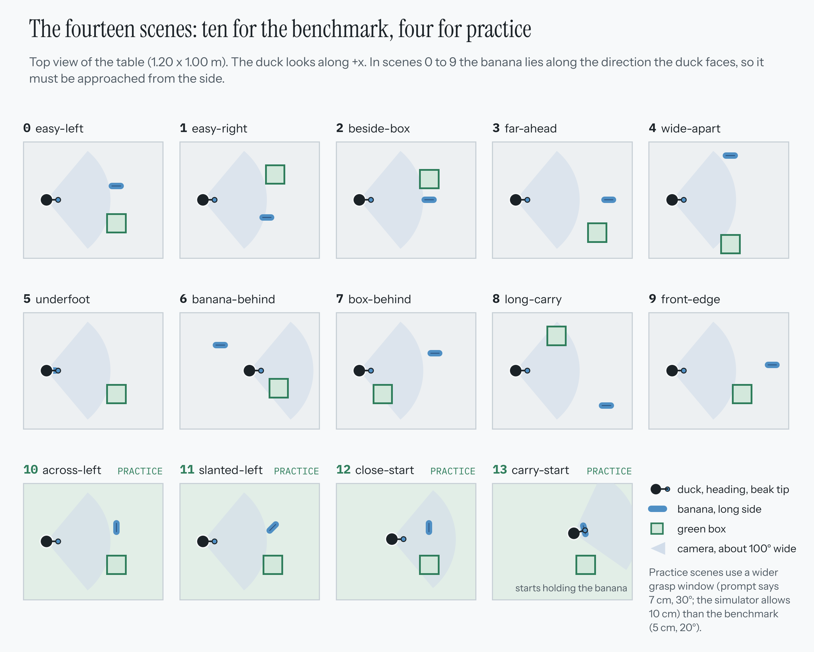

**What we tested, in order**

| # | Test | Question it answers | Section |
|---|---|---|---|
| 1 | One scene, random seeds: rule brain vs Gemma 4 e2b | Can a model follow the recipe at all? | 2.1 |
| 2 | Fault test: the banana is knocked 20 cm away after the first call | Does the duck re-observe? Do guardrails cost anything? | 2.1 |
| 3 | Memory experiment: train seeds, test seeds, two controls | Does a notebook the duck writes make it better? | 2.1 |
| 4 | 10 benchmark scenes, one attempt each, rule brain vs Gemma, with and without the camera "eye" | Does the recipe work on every scene? | 2.3 |
| 5 | `pointing_check`: can the model find the banana and box in its own picture? | Is perception good enough for any planning to work? | 4.3 |
| 6 | Autonomous benchmark (no recipe) | Can the model do the task alone? | 4 |
| 7 | Learner: attempt, verdict, reflect, notebook, retry | Does the duck get better by writing notes? | 5 |
| 8 | Control: the same ladder with the notebook switched off | Is it the notebook, or luck? | 5.3 |

**Setup of the logged runs:** Windows 10 PC with an RTX 3050 (4 GB), Python 3.12.8, MuJoCo 3.17.0, ONNX Runtime 1.31.1, Ollama 0.40.14 serving `gemma4:e2b` (a download of about 4.6 GB) and later `gemma4:e4b` (about 6.6 GB).

---

## 2. Stages 0 to 2: the scripted recipe

### 2.1 The first harness: faults, guardrails, and a notebook that made things worse

Before building scenes, we built a harness around one scene (the seeds only change where the banana and box lie) and compared a **rule brain** (if-statements, no model) with **Gemma 4 e2b** (thinking off, temperature 0). The harness had three switches:

* **panel**: after each tool result the model is also *told in words* what happened (a status line).
* **guard**: the guardrails are active (table-edge refusal, false-`done` rejection, loop and failure budgets).
* **kick**: a fault. After the first tool call the banana is knocked 20 cm away, without telling the duck.

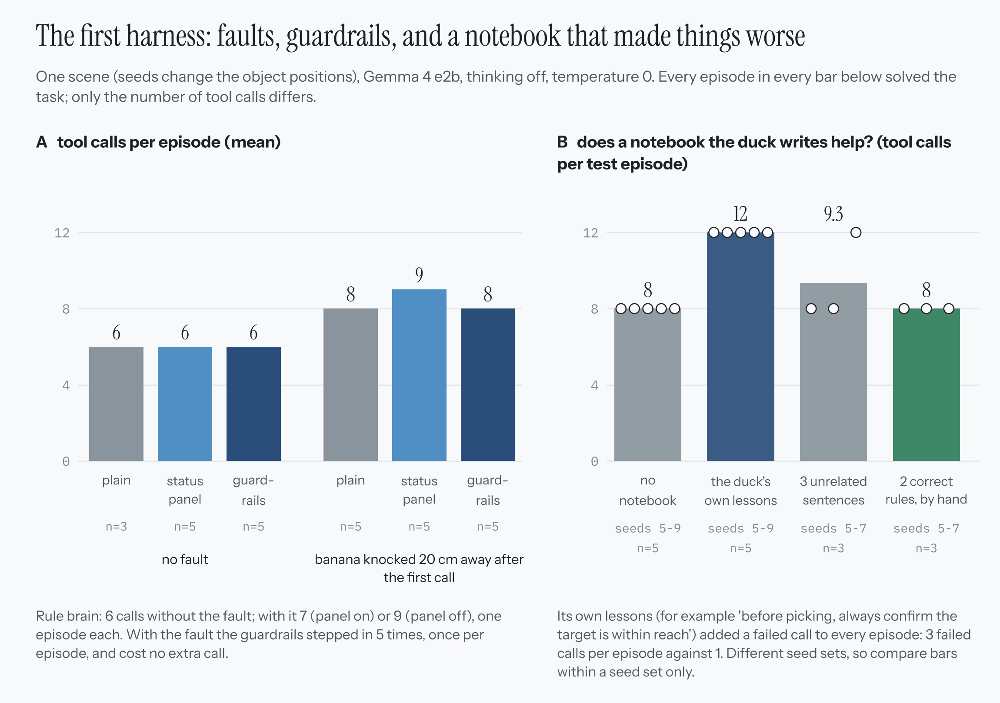

**Panel A (faults and guardrails).** Without a fault, Gemma needs 6 tool calls, the same as the rule brain, with and without the panel or guardrails. With the banana knocked away it needs 8, and the status panel made it slightly *worse* (9). The guardrails stepped in once per episode (5 of 5) and cost no extra call. Every episode in every condition solved the task. The rule brain took 6 calls without the fault and 7 (panel on) or 9 (panel off) with it, one episode each.

**Panel B (the memory experiment).** Five training episodes (seeds 0 to 4) with the fault on: after each, Gemma wrote a lesson for its future self, and the lessons merged into a notebook of three sentences that was added to the system prompt. The test used **different seeds** from the training (so we measure learning, not memorising):

| Test condition | Mean tool calls | Mean failed calls | Mean model time |
|---|---|---|---|
| No notebook (seeds 5-9, n = 5) | 8.0 | 1 | 22.7 s |
| **The duck's own lessons** (seeds 5-9, n = 5) | **12.0** | 3 | 33.7 s |
| 3 unrelated sentences: raincoat, tea, library book (seeds 5-7, n = 3) | 9.3 | 1.7 | 26.5 s |
| 2 correct rules written by hand (seeds 5-7, n = 3) | 8.0 | 1 | 22.7 s |

Gemma's own lessons were generic ("before picking, always confirm the target is within reach") and added a failed call to every episode. Rules written by a person did no harm and no good either, because the scene was already easy. The placebo and the hand-written sets used only 3 episodes each, so do not read more into them than "a small model can be disturbed by any extra text". **This was the first sign that a notebook is not automatically useful**; it comes back in Stage 4.

### 2.2 The recipe architecture (stages 1 and 2)

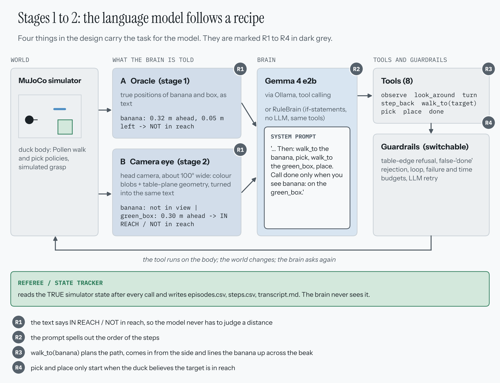

Four things carried the task for the model. We marked them **R1 to R4** because Stage 3 removes each of them:

| Mark | What did the work | Where |
|---|---|---|
| **R1** | The perception text said **IN REACH / NOT in reach**, so the model never had to judge a distance. | Stage 1: the simulator's true positions turned into text. Stage 2: a colour-blob camera "eye" made the same kind of text from the real picture. |
| **R2** | The system prompt spelled out the order: *walk_to the banana, pick, walk_to the green_box, place, call done only when you see banana: on the green_box.* | prompt |
| **R3** | `walk_to(banana)` planned the path, came in from the side and lined the banana up across the beak. | tool code |
| **R4** | `pick` and `place` only started when the duck believed the target was in reach. | tool code |

The tools: Stage 1 had five (`walk_to`, `pick`, `place`, `observe`, `done`; 14-call cap). Stage 2 had eight (`observe`, `look_around`, `turn`, `step_back`, `walk_to`, `pick`, `place`, `done`; 16-call cap). The `look_around` search tool was not there in the first Stage 2 run and was added for the next one. The behaviour guard was off in these runs.

### 2.3 Results of stages 0 to 2

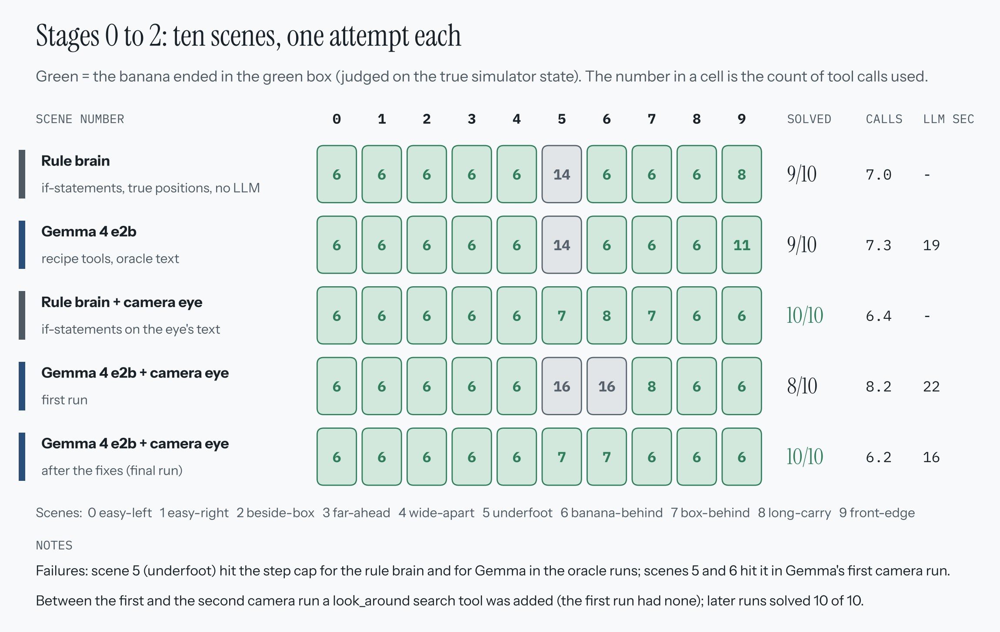

* **Stage 0, rule brain with the true positions:** 9 of 10, 7.0 calls. Scene 5 ("underfoot", the banana 4 cm in front of the feet) loops until the 14-call cap.
* **Stage 1, Gemma 4 e2b with the oracle text:** 9 of 10, 7.3 calls, 19.4 s of model time per scene (2.7 s per call). Same failure on scene 5; scene 9 needed 11 calls.
* **Stage 2, with the camera eye:** the first run solved 8 of 10 (scenes 5 and 6 hit the 16-call cap). The next four runs, after the `look_around` tool was added, all solved **10 of 10** (6.4, 6.2, 6.2 and 6.2 calls); the last one took 16.4 s of model time per scene. The rule brain with the same eye also solved 10 of 10 (6.4 and then 6.2 calls).
* One intermediate rule-brain run scored 7 of 10 (scenes 4, 5 and 6 hit the cap).

**Why we did not stop here.** With a recipe the model is replaceable: an if-statement brain gets the same score. The code did the geometry (`walk_to`, colour vision, "IN REACH"), so these runs say little about whether the model can plan. We decided Franky must be a genuinely autonomous agent: a loose command in, its own tools out, no recipe, no hard-coded targets.

---

## 3. Choosing the brain: Qwen and Gemma

**The question.** Which small vision-language model can be Franky's brain on a laptop GPU with 4 GB of memory? We wrote `diagnostics/llm_speed_test.py` for this. For each model it measures how much of the model sits on the GPU (a spill to the CPU makes it slow), load time, tokens per second, and runs a decision test: six scenes in which the model is told what it sees and must pick the right tool, timed. The default candidates in the script are `qwen3-vl:2b`, `gemma4:e2b` and `gemma3:4b`.

**What was decided.** Franky (duck1) uses **Gemma 4**: `gemma4:e2b` first, `gemma4:e4b` from the third real run on. The project notes give the reasons: tool calling, vision, a thinking mode, native box detection, running locally on the RTX 3050 (4 GB), and the project goal of an agent brain that observes, plans, remembers and learns. The second duck, Thami (duck2), is configured for `qwen3-vl:2b-instruct` and was set aside; it was not touched.

**What we can show, and what we cannot.** The speed test prints its table to the terminal and saves nothing, and we could not find its output in the project files or logs. **So this README has no Qwen numbers, and we did not invent any.** The chart marks the gap with a dashed slot. What the logs do hold is how the chosen model behaved on this card, stage by stage:

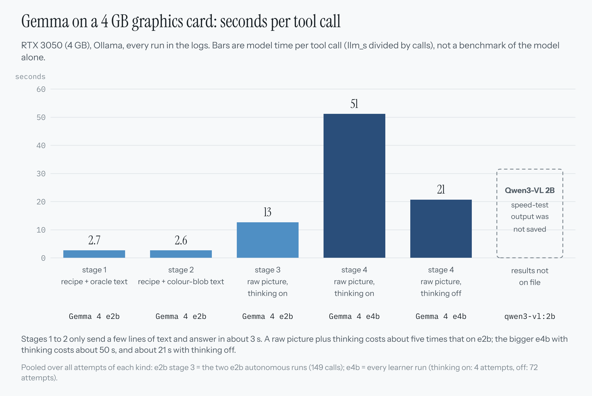

| Configuration | Model time per tool call | Source |
|---|---|---|
| e2b, recipe + oracle text (stage 1) | 2.7 s | the `gemma4-e2b_scenes` run folder |
| e2b, recipe + colour-blob text (stage 2) | 2.6 s | the last `gemma4-e2b_scenes_eye` run folder |
| e2b, raw picture, thinking on (stage 3) | 12.6 s | the two e2b autonomous runs, 149 calls |
| e4b, raw picture, thinking **on** (stage 4) | 51 s | 4 attempts, 68 calls |
| e4b, raw picture, thinking **off** (stage 4) | 20.7 s | 72 attempts, 2065 calls |

A real picture plus thinking is about five times more expensive than a few lines of text, and e4b with thinking is about 50 s per call. A 40-call attempt takes 11 to 14 minutes of model time and its reflection 2 to 4 minutes (section 5.4).

> **To fill the gap:** run `python diagnostics\llm_speed_test.py qwen3-vl:2b gemma4:e2b gemma3:4b --runs 3` and paste the output; a Qwen vs Gemma chart can then be added in the same style.

---

## 4. Stage 3: the autonomous agent

### 4.1 What changed, and what was kept

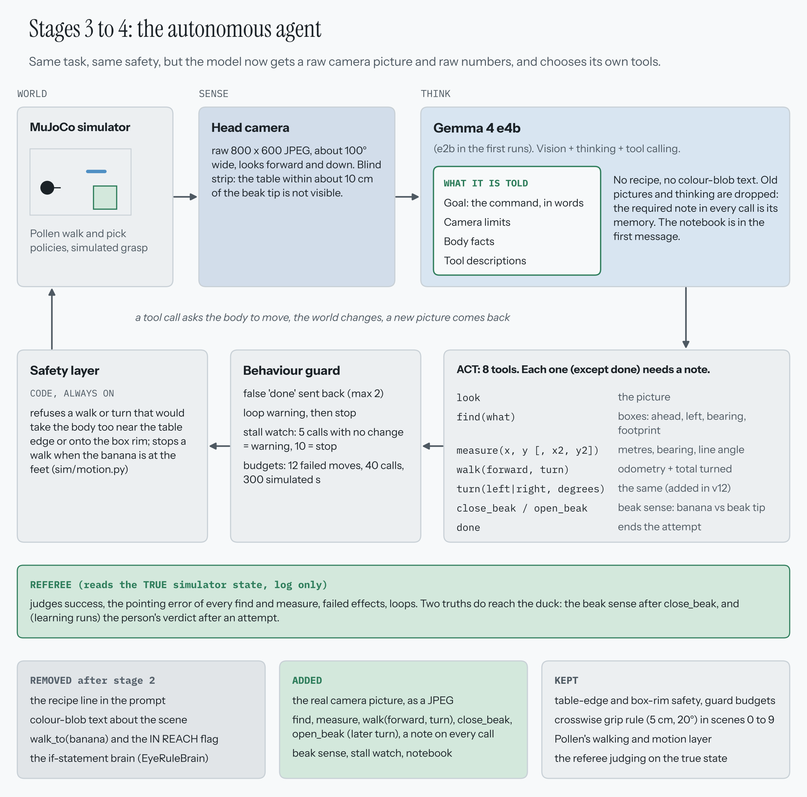

| Removed after stage 2 | Added | Kept |
|---|---|---|
| the recipe line in the prompt | the real camera picture, as a JPEG | table-edge and box-rim safety, guard budgets |
| colour-blob text about the scene | `find`, `measure`, `walk(forward, turn)`, `close_beak`, `open_beak`; a **note on every call**; (`turn(direction, degrees)` joined in v12) | crosswise grip rule (5 cm, 20 degrees) in scenes 0-9 |
| `walk_to(banana)` and the IN REACH flag | beak sense, stall watch, notebook | Pollen's walking and motion layer |
| the if-statement brain (`EyeRuleBrain`) | | the referee judging on the true state |

The prompt is now only: the **goal** (the command in words), the **camera limits**, **body facts** and the **tool descriptions**. No recipe, no advice.

The tools return raw data: `look` (the picture), `find(what)` (the model's own native detection box, on a 0-1000 scale, turned into ahead / left / bearing / footprint), `measure(x, y, ...)` (pixels to metres and bearing), `walk` (the real odometry plus the total turned since the start), `close_beak` / `open_beak`, `done`. A **note is required on every call except `done`**, because the model's thinking is not replayed to it on the next turn: the notes are its only memory within an attempt.

**Safety layer** (`sim/motion.py`, always on): refuses a walk or turn that would take the body over the table edge or onto the box rim, with a bumper for the banana.

**Behaviour guard:** a false `done` is sent back (at most 2 times); a loop warning then a stop; a **stall watch** (5 calls that change nothing = a warning, 10 = stop); budgets of 12 failed moves, 40 calls and 300 simulated seconds.

**What the duck is still given for free:** its own position and heading (odometry), the camera pose at picture time, the table height (so a pixel can become metres), and the safety layer. The truth reaches the duck in only two places: the **beak sense** after a close, and the person's **verdict** after an attempt.

### 4.2 The first real runs: what went wrong

| Run | Model | What happened |
|---|---|---|
| 1st (version 1) | e2b, thinking on | Recognised the banana and box but its `measure` spots were far off (median error 19.7 cm banana, 15.8 cm box; the banana line 89 degrees wrong in all 7 scenes). It **never called `walk`**: in scene 0, 14 looks, 11 picks and 3 measures in 28 calls, picking from 40 cm away (it thought `pick` takes coordinates). About 10-14 s per step. Five episodes, none solved: scenes 0, 1, 2 ended by the loop guard after 28, 16 and 4 calls; scenes 3 and 4 by the failure budget after 32 and 29 calls. |
| 2nd (version 2: `find` added) | e2b | The boxes were on the right *kind* of thing in the wrong place: banana median 26.5 cm, green box 20.5 cm. The error is systematic in y (far things too low, near big things too high). It still never walked: it treated `pick` as an atomic skill and followed find, pick, find, place. |
| 3rd (version 3: low-level beak tools, required notes, padding available) | e2b, no padding | First time the duck walked toward the banana. Still closed the beak from far away and walked 0.5 m past the banana out of sight. Two episodes, none solved: scene 0 ended by the failure budget after 20 calls, scene 1 by the stall guard after 20 calls. |

### 4.3 Can the model find things in its own picture?

Everything depends on one skill, so we tested it alone (`pointing_check`: ask the model for a box around the banana and the green box in each scene, and compare with the truth). The error is the distance in cm from the spot the model chose (the middle of its box, where it touches the table) to the **body** of the true object; 0 means the spot is on the object. The banana is thin, so that is a strict test; the green box is large, so a spot anywhere on it scores 0.

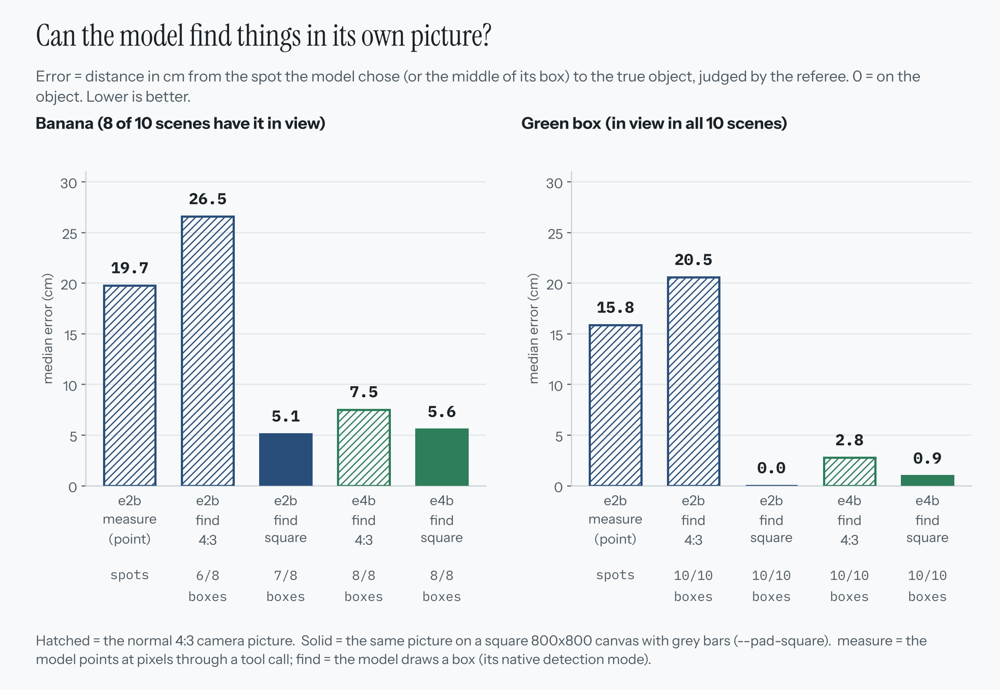

| Configuration | Banana median error | Green box median error | Boxes returned (banana / green box) |
|---|---|---|---|
| e2b, pointing through `measure` | 19.7 cm | 15.8 cm | spots |
| e2b, `find` on the normal 4:3 picture | 26.5 cm | 20.5 cm | 6 of 8 / 10 of 10 |
| e2b, `find` on a **square** picture (grey bars) | **5.1 cm** | **0.0 cm** | 7 of 8 / 10 of 10 |
| e4b, `find` on the normal 4:3 picture | 7.5 cm | 2.8 cm | 8 of 8 / 10 of 10 |
| e4b, `find` on a **square** picture | 5.6 cm | 0.9 cm | 8 of 8 / 10 of 10 |

Two readings:

1. **The square picture matters a lot.** On a 4:3 picture the model's y coordinate is systematically wrong; on an 800 x 800 canvas with grey bars it largely goes away, for both models.
2. **A finding the project notes did not report:** the log of the same run (the e2b `find` pointing log) shows that **e2b on the square picture points about as well as e4b** (banana 5.1 vs 5.6 cm; green box on the object in 9 of 10 scenes against 3 of 10 for e4b, and within 3 cm in all 10 for both). The difference is that e2b found no banana at all in one scene (scene 3). We switched to e4b and to padding at the same moment, so we do not know how much of the later progress came from the bigger model and how much from the padding. The control (e2b with `--pad-square on` in the full agent) was not run.

---

## 5. Stage 4: the duck that learns

### 5.1 The loop

The idea came from an observation on the third real run: every scene starts with the same early mistakes (observe, try the beak, change action). The duck should learn from the first scene and use it.

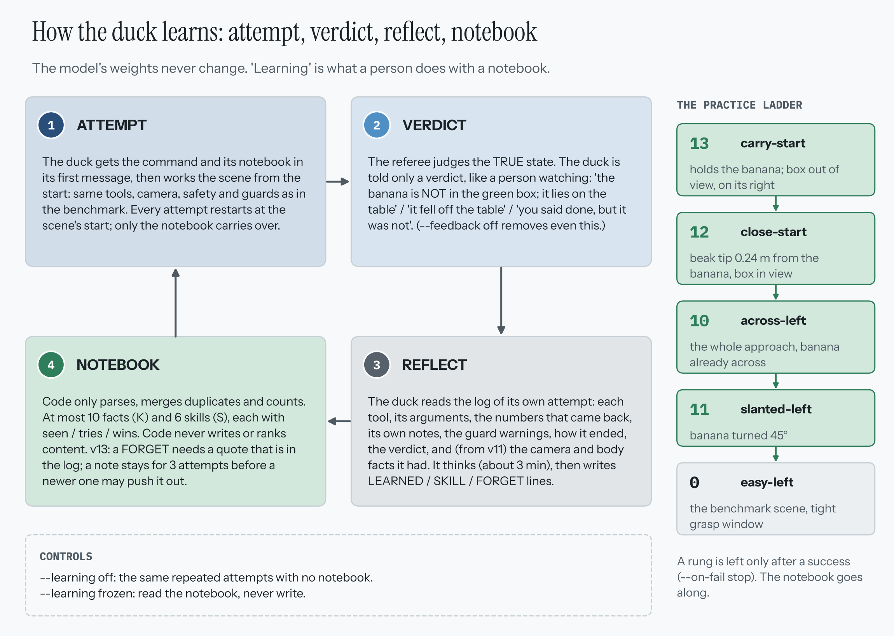

1. **Attempt.** The duck gets the command and its notebook in the first message and works the scene from the start. Every attempt restarts at the scene's start; only the notebook carries over.
2. **Verdict.** The referee judges the true state; the duck is told only what a person watching would say: *the banana is NOT in the green box, it lies on the table* / *you are still holding the banana* / *you said done, but it was not.*
3. **Reflect.** The duck reads the log of its own attempt (each tool, arguments, the numbers that came back, its own notes, guard warnings, how it ended, the verdict, and from v11 the camera and body facts it had) and thinks for about 3 minutes, then writes `LEARNED:`, `SKILL:` or `FORGET:` lines.
4. **Notebook.** Code only parses, merges duplicates and counts. At most **10 facts (K)** and **6 skills (S)**; every note carries `seen / tries / wins`. Code never writes or ranks content.

**The weights never change.** "Learning" here means exactly what a person does with a notebook.

**The practice ladder.** The duck climbs 13, 12, 10, 11, then scene 0, and moves up only after a success (`--on-fail stop`). Controls: `--learning off` (repeat the scene with no notebook) and `--learning frozen` (read, never write).

### 5.2 Every attempt we made

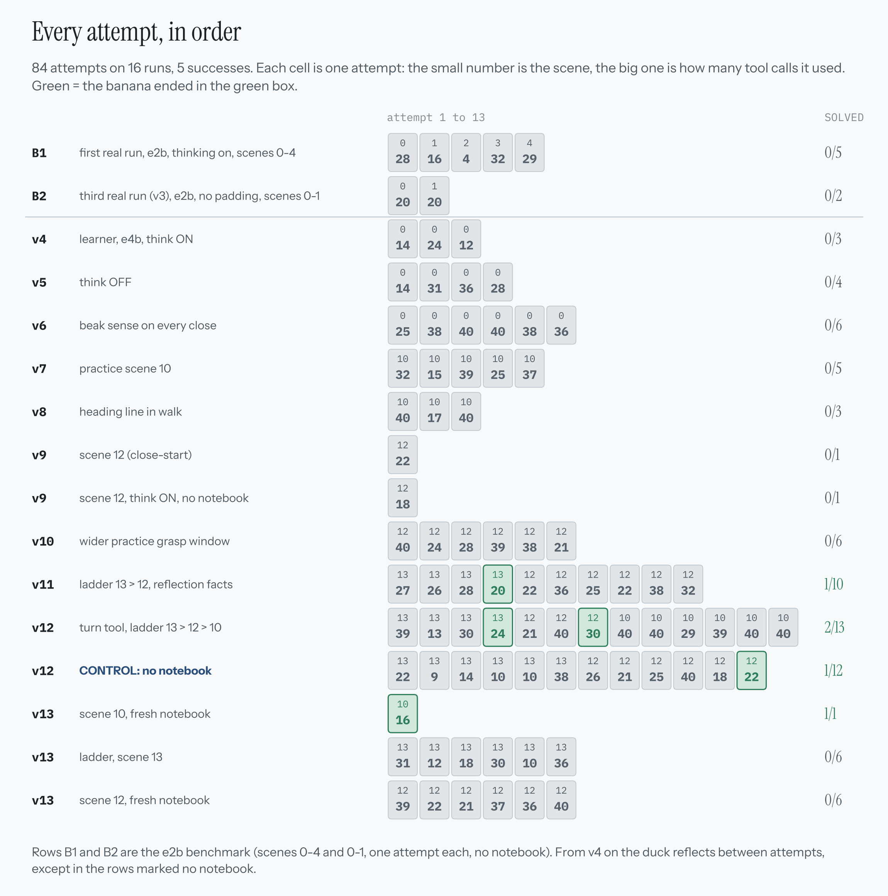

84 attempts on 16 runs, 5 solved. Each cell is one attempt (small number = scene, big number = tool calls). Before v11 there was not one success in 36 attempts (7 benchmark episodes plus 29 learner attempts on scenes 0, 10 and 12). The first success came in v11, the run that introduced practice scene 13; the others followed in v12, the control and v13.

### 5.3 Did the notebook help? A control experiment

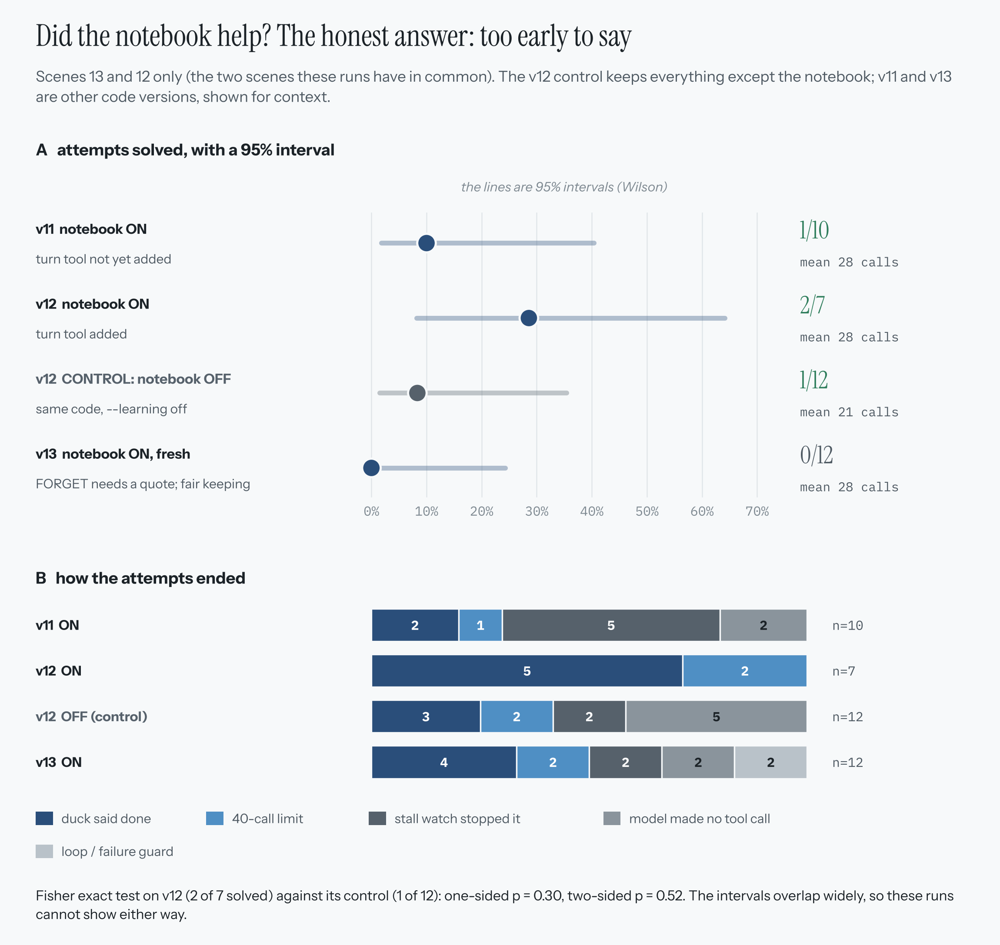

| Run | Code | Notebook | Scene 13 | Scene 12 |
|---|---|---|---|---|
| v11 | no `turn` tool | on | 1 of 4 | 0 of 6 |
| v12 | `turn` tool | on | 1 of 4 | 1 of 3 |
| v12 control | `turn` tool | **off** | 0 of 6 | 1 of 6 |
| v13 | + quote rule + fair keeping | on, fresh | 0 of 6 (ladder) | 0 of 6 |

On scenes 13 and 12 the v12 duck solved **2 of 7** attempts with its notebook and the control **1 of 12** without it. The direction is what we hoped for, but a one-sided Fisher exact test gives **p = 0.30** (two-sided 0.52), and the 95% intervals (8-64% against 1-35%) overlap widely. **The notebook is not shown to help.**

The endings are more interesting than the totals. Without the notebook 5 of 12 attempts ended because the model sent an **empty reply** (`no_tool_calls`); with the notebook none of the 7 v12 attempts on scenes 13 and 12 ended that way, and none ended by the stall watch. The control also shows where the model fails with no memory at all: it repeats `find(green box)` when the box is out of the picture, and it opens the beak short of the box.

The same data says something about the `turn` tool (v12): scene 12 was solved in 2 of 9 attempts with it (v12 and its control) against 0 of 12 before it (v10 and v11). A one-sided Fisher test gives p = 0.17, so that is a hint, not a result.

### 5.4 What thinking costs

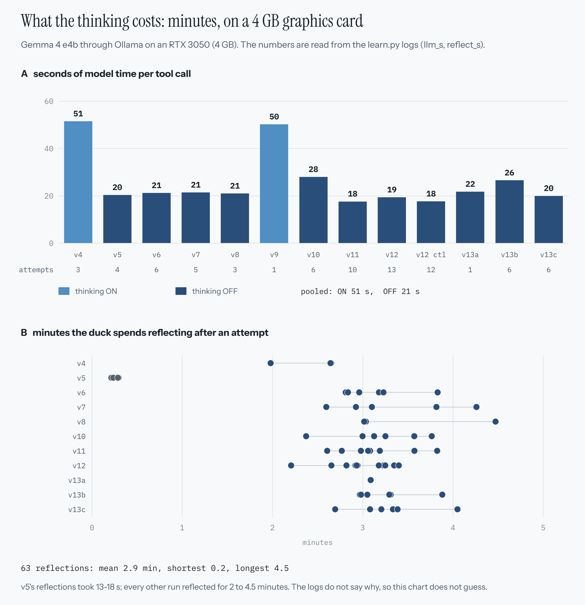

On the 4 GB card an e4b call costs about 51 s with thinking on and 20.7 s with it off, so almost every learner run used `--think off`. The reflection still thinks: 63 reflections took 2.9 minutes on average (longest 4.5 minutes). The one exception is v5, whose four reflections took 13 to 18 seconds; the logs do not say why. The 13 learner runs on file add up to about 16 hours of attempt and reflection time.

---

## 6. Every major change: why, what, result

| Ver. | Problem seen | Change | Result |
|---|---|---|---|
| 1 | Recipe design: the code does the geometry | Rebuilt as an autonomous agent: raw picture, raw tools, no recipe, no `walk_to` | First real run: e2b never walked; picked from 40 cm; spots 15-20 cm off |
| 2 | Pointing through `measure` is poor | `find(what)` (native boxes), plain facts in tool descriptions, stall watch | Boxes in the wrong place (banana 26.5 cm); still never walked |
| 3 | `pick` taken as an atomic skill | `close_beak` / `open_beak` low-level; a **note required** on every call; beak-tip line; `--pad-square` | First walk toward the banana; e4b + square picture measured 5.6 / 0.9 cm |
| 4 | The same early mistakes in every scene | `learn.py`: attempt, verdict, reflect, notebook; controls `--learning off / frozen` | 3 attempts, 0 solved; 47 s per call with thinking; generic notes |
| 5 | Closes that miss say only "not under your beak" | **Beak sense** line after a failed close (where the banana is, angle of its long side); `--think off` | 4 attempts, 0 solved; only one close took the banana, by luck; the reflection wrote a wrong reason |
| 6 | The success said nothing; the failure budget counted looking | Beak sense on **every** close; the reflection thinks even with `--think off`; the budget counts failed moves only | 0 of 6; the notebook made things worse (creeping steps); 33 closes, none across the banana |
| 7 | No grasp to learn from | Compact terminal; practice scenes **10** and **11**; notes must be backed by the log | 0 of 5 on scene 10; first closes within 5 cm, all missed by 2-10 degrees: the heading had **drifted 22-30 degrees left** |
| 8 | Heading drift unseen by the duck | **"Total turned since the start"** in every `walk` result | 0 of 3 on scene 10 (ended: max steps, empty reply, max steps); the heading line shows in the next run's walk results (10, 15, 20, 24 degrees left) |
| 9 | Starting far away hides the hard part | Practice scene **12** (close start) | False `done`: the duck argued itself out of "did NOT take the banana". The think-on run read it correctly, but was 1 degree outside the window and could not fix it |
| 10 | The grasp window is narrow against the walk's noise | Wider **practice-only** grasp window (simulator 10 cm, 30 degrees; the duck is told "about 7 cm and 30 degrees") | First banana carried (7 grasps in 3 of 6 attempts); every attempt then failed at the box, which was **out of the picture** (85-90 degrees to its right) |
| 11 | The reflection blamed the vision model for a box that was simply out of view | The reflection gets the camera and body facts; practice scene **13** (carry start); the unknown-tool message points to `walk` | **First success**: scene 13 after 4 attempts. Sign errors: "turn right 45" sent as `turn=45` (which turns left) at least 4 times |
| 12 | The sign trap | `turn(direction, degrees)` tool (left or right, never negative) | Scene 13 in 4 attempts, scene 12 in 3: **first grasp + carry + place**. Scene 10: 0 of 6 |
| 12c | Is it the notebook or luck? | Control: the same code, notebook off, scenes 13 and 12 | 1 of 12 attempts solved (scene 12, attempt 6) |
| 13 | Good notes were pushed out; wrong notes forgotten | **FORGET must quote the log**; **fair keeping** (a note stays at least 3 attempts) | Scene 10 solved at attempt 1 with a fresh notebook (16 calls, no notes used). The ladder: 0 of 6 on scene 13; scene 12 0 of 6. "Changed nothing measurable" |

Three engineering findings worth keeping:

* **The grasp window is not where the prompt says it is.** The simulator tests a 3-D distance from the **mouth** point (2.8 cm above the table, about 3 cm behind the nominal beak tip). At the benchmark radius of 5 cm the banana is taken from 2 cm ahead, 3 to 4 cm to the side, but 9 cm *behind* the nominal tip. The benchmark prompt ("within about 5 cm of your beak tip") therefore overstates the reach ahead. We left the benchmark unchanged to keep it comparable, and moved only the practice scenes to a wider window.
* **Heading drift decides the grasp.** In the seventh run each walk ended 2 to 11 degrees left of what was asked; five close attempts within 5 cm of the banana missed by 2 to 10 degrees for exactly that reason, which is why v8 added the heading line.
* **Replays differ across machines.** The two successes were re-run from the logged decisions in the cloud to make proof videos. Both end with the banana in the box, but the physics is not identical to the real run (16 of 30 steps differ in their numbers in scene 12; 10 of 25 in scene 13). Two cloud replays agree with each other, and replaying the earlier episodes first changes nothing, which points to the machine and software rather than the history. The videos are labelled "replay of the logged decisions". Watch them: [scene 12, attempt 3](docs/videos/scene12_attempt3_replay.mp4) (27.7 s, 30 tool calls) and [scene 13, attempt 4](docs/videos/scene13_attempt4_replay.mp4) (27.1 s, 24 tool calls).

---

## 7. The learning duck in cases

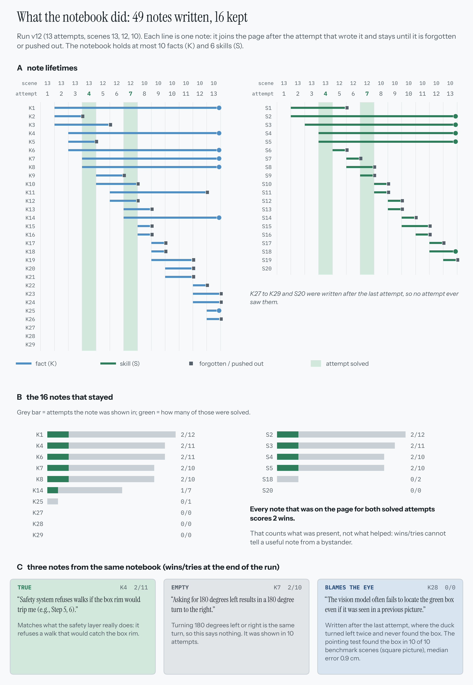

**Case 1: the notebook churns.** In v12 the duck wrote 49 notes in 13 attempts. 5 were deleted by FORGET, 28 were pushed out to make room, 16 stayed; 17 of the 33 that left were gone after being shown once. The old rule scored a note as `wins x 3 + seen`, so a note that was shown in two successful attempts got permanent protection for merely being there: 10 of the 16 places were held by notes from scene 13. This is what v13 tried to fix; with fair keeping, only 1 of 34 departing notes was gone after one attempt (in a replay of the 13 real reflections).

**Case 2: wins and tries are bystander counts.** Every note that was on the page for both successful attempts scores 2 wins, whether or not it helped. The credit is by presence, not by cause.

**Case 3: the duck blames its eye.** Notes such as "the vision model often fails to locate the green box" appeared in v10 (K2, K6, K9), v11 (K10, K18) and v12 (K28). In the logs the box was simply **out of the picture** after a wrong-way turn. The reflection had the camera facts from v11 on and still wrote it, and in the v13 ladder the notebook ended up mostly about the vision model. The pointing test shows e4b places the green box within a median 0.9 cm when it is in the picture.

**Case 4: the lesson that mattered was never written.** After the grasp the box lies 85-90 degrees to the right, outside the camera's +-50 degrees. The lesson "turn right 60-90 degrees" is what separates a success from a failure on scenes 13 and 12. In v11 the duck found it only by trying a 111-degree right turn at attempt 4, and the notebook did not record it. In v12 the clean solution (scene 12, attempt 3) was:

```
walk(0.1, turn +18) -> close_beak (missed) -> walk 0.1 -> close_beak TAKEN -> walk 0.1
-> turn(right, 90)  (turned 93 degrees)  -> box found -> walk 0.15 -> two walks refused by the rim
-> turn(right, 10), turn(right, 5) -> open_beak over the box -> done: banana 0.07 m from the box centre, in the box
```

[Watch this attempt as a replay](docs/videos/scene12_attempt3_replay.mp4).

**Case 5: correct notes get forgotten.** In v12 the correct grasp-rule notes K11 and K26 were forgotten in attempts 5 and 6 of scene 10 because the log "seemed to contradict" them, and the wrong K27 ("pickup can occur even if the long side is far from across the beak, e.g. 72 degrees") was added. In v13 the quote rule refused 3 of 4 FORGET lines (the duck quoted the note's own text, not the log), but let one through: a real log line that had nothing to do with the note.

**Case 6: the duck ignores a plain result.** Twice (run 8-9 on scene 12, attempt 1; and the v12 control on scene 12, attempt 1) the duck wrote that it had picked up the banana right after the tool said "did NOT take the banana, your beak is empty". The notebook did not remove this; it is a reading fault of the think-off 4B model.

---

## 8. What is proven, and what is not

**Shown by the logs**

* A recipe turns an e2b model into a 10-of-10 solver, and an if-statement brain with the same eye gets the same score.
* Without a recipe, e2b on a 4:3 picture cannot locate things (median 20-26 cm off); on a square picture the error falls to about 5 cm, for both e2b and e4b.
* A notebook the model writes for itself is not automatically useful: in the first harness it made Gemma slower (12 calls against 8), and in Stage 4 it is not shown to help.
* The `turn` tool removed the sign error, and the beak sense with the heading line gave the duck numbers it could use.
* The first success, the first carried banana and the first full grasp + carry + place by the autonomous agent are logged (section 6).

**Not shown**

* That the notebook improves the success rate (2 of 7 against 1 of 12, p = 0.30 one-sided).
* That the `turn` tool improves scene 12 (2 of 9 against 0 of 12, p = 0.17 one-sided).
* That the e4b model is needed: the pointing test suggests padding alone does most of it, and the matching agent run (e2b with `--pad-square on`) was not done.
* That any of this transfers to the benchmark. All Stage 4 successes are on practice scenes with a wider window (told 7 cm / 30 degrees, simulator 10 cm / 30 degrees) than the benchmark (5 cm / 20 degrees); the autonomous duck solved no scene 0-9 attempt.
* Qwen against Gemma: the speed-test numbers were not saved (section 3).

**Limits to keep in any write-up**

* n is tiny: 5 successes in 77 learner attempts, runs of 1 to 13 attempts.
* The duck is still given odometry, the camera pose, the table height and the safety layer.
* The grasp is simulated by code, not by a jaw.
* The v12 `turn` tool and the v13 changes altered the code between runs, so v11, v12 and v13 are not a clean series. Only v12 and its control share the code.
* The benchmark prompt overstates the reach ahead of the beak (section 6).

**Next steps.** From the project notes: run the benchmark scenes 0 to 9 for the comparison with Thami's duck; cap the intake at two facts and one skill per reflection; repeat the ladder with `--on-fail continue` and `--learning off` for a paired comparison (about 3 hours each). New from this write-up: the matching **e2b + square** agent run, to separate the effect of the model size from the effect of the padding.

---

## 9. How to run it

**One-time setup**

1. Python 3.12 and the packages: `pip install -r requirements.txt`.
2. Pollen's Microduck robot model is not included here: clone [pollen-robotics/microduck_rl](https://github.com/pollen-robotics/microduck_rl) into the project folder, next to `project_paths.py`. Its 3D model files are CC BY-NC-SA 4.0, so they stay in Pollen's repo.
3. Pollen's pretrained ONNX policies are not included either. Pollen's README names the official set `pollen-robotics/microduck-policies` on Hugging Face; download it into `assets/policies/`:

   ```powershell
   pip install huggingface_hub
   python -c "from huggingface_hub import snapshot_download; snapshot_download('pollen-robotics/microduck-policies', local_dir='assets/policies')"
   ```

4. [Ollama](https://ollama.com) running, with `gemma4:e2b` and `gemma4:e4b` pulled (`ollama pull gemma4:e2b`).

**Commands** (PowerShell, from the project folder)

```powershell
# can the model find things in its picture?
python duck1\pointing_check.py
python duck1\pointing_check.py --model gemma4:e4b

# the main way: the duck learns, practice ladder first, then scene 0
python duck1\learn.py --scenes 13 12 10 11 0 --view --fresh --think off
# control: no notebook
python duck1\learn.py --scenes 13 12 --attempts 6 --learning off --on-fail continue --view --think off

# the benchmark, one attempt per scene, no learning
python duck1\scene_benchmark.py --model gemma4:e4b --pad-square on --view --record

# the speed test for the Qwen vs Gemma gap
python diagnostics\llm_speed_test.py qwen3-vl:2b gemma4:e2b gemma3:4b --runs 3

# replay a logged attempt (for a proof video); use your v12 run folder in place of <v12 run folder>
python diagnostics\replay_run.py --run outputs\logs\duck1\<v12 run folder> --episode 7 --record
```

**Reading a run** (`outputs\logs\duck1\run_<time>_...\`): open `transcript.md` first (what the model thought, which tool it called with which note, what came back, what the referee found). `steps.csv` and `episodes.csv` open in Excel; `learning.csv` has one row per attempt; `run_meta.json` holds the exact prompt, tool list, model settings and code hashes.

```
MicroDuck Robot/
  project_paths.py   every folder of the project in one place
  docs/              figures, TECHNICAL_NOTES.md (the long version log), videos/ (two replay clips)
  sim/               duck body, safety layer (motion.py), head camera, recorder
  agent_harness/     agent loop, behaviour guard, referee (true state), Gemma client; the older harness v1
  duck1/             Franky: scenes, tools and prompt, learn.py, notebook, pointing_check, scene_benchmark
  duck2/             Thami's test set (blue box + green box, two bananas), not changed
  diagnostics/       llm_speed_test, scripted_baseline, replay_run and other small checks
  assets/            not in this repo: Pollen's ONNX policies go in assets/policies (see setup)
  microduck_rl/      third-party: the official Pollen repo (clone it yourself, see setup; only its robot model is used)
  outputs/           logs/ (duck1, duck2, harness_v1), videos/, memory/ (franky_notebook.json + .md)
                     (this GitHub repo keeps the csv / json / markdown logs; camera frames and videos are left out)
  _old_franky_before_autonomy/   the recipe-era Franky, kept for reference
```

The long technical log of every version (all flags, every test) is in [docs/TECHNICAL_NOTES.md](docs/TECHNICAL_NOTES.md).

---

## 10. Where every number comes from

| Figure | Data |
|---|---|
| 01 journey, 04 recipe results | the stage 0, 1 and 2 run folders in `outputs/logs/duck1/` (`episodes.csv`) |
| 02 scenes | `duck1/scenes.py` |
| 05 first harness, memory experiment | `outputs/logs/harness_v1/` (`episodes.csv`); notebooks in `outputs/memory/` (`lessons_gemma4-e2b.json`, `placebo.json`, `mine.json`) |
| 06 Gemma speed | `llm_s` and `steps` columns of `episodes.csv` and `learning.csv` |
| 08 pointing | the three pointing logs: e2b `measure`, e2b `find` (4:3 and square) and e4b `find` (4:3 and square) |
| 10 all attempts | every `learning.csv`, the two e2b benchmark runs (the first and the third real run), and the scene-12 run that was stopped during its first reflection (read from that run's `episodes.csv`) |
| 11 notebook vs control | `learning.csv` of v11, v12, the v12 control and v13; test: Fisher exact on 2 of 7 against 1 of 12 |
| 12 notebook cases | the notebook files and `learning.csv` of the v12 run |
| 13 time cost | `llm_s` and `reflect_s` columns of `learning.csv` |
| Version history, findings, replays | [docs/TECHNICAL_NOTES.md](docs/TECHNICAL_NOTES.md) and the design notes kept during the project |

---

**Credits.** The Microduck robot model and its pretrained policies come from Pollen Robotics ([microduck_rl](https://github.com/pollen-robotics/microduck_rl), Hugging Face). The servo model is the open-source `better-actuator-models` (BAM) package. The language models are Google's Gemma 4, run locally through Ollama.
